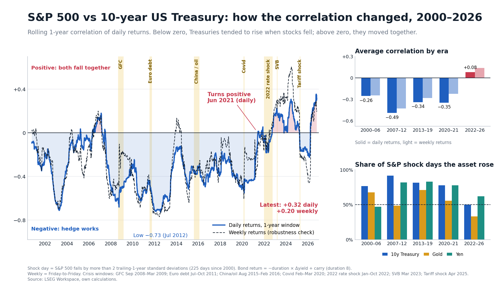
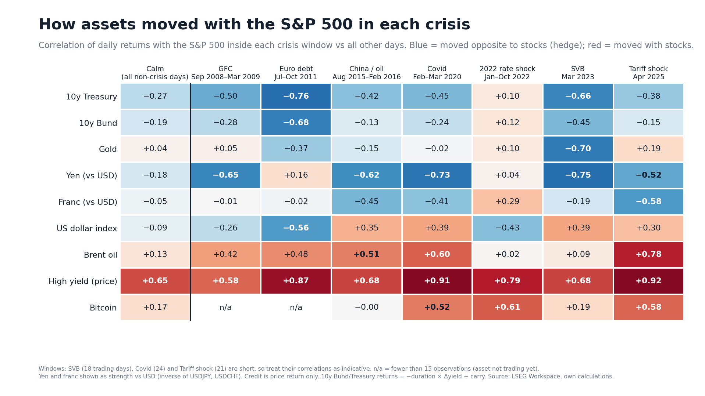

# Cross-asset correlations and crises, 2000–2026

How the correlation between asset classes has changed, and how different assets behaved in each major crisis. Built from daily LSEG Workspace data (Jan 2000 – Oct 2026).




## Questions
1. Is a Treasury still a hedge against equity losses? How did the S&P 500 / 10-year Treasury correlation change?
2. In each crisis (GFC, Euro debt, China/oil, Covid, 2022 rate shock, SVB, Tariff shock), which assets moved with equities and which against them?

## Key results
- S&P 500 vs 10y Treasury return correlation (daily): 2007–12 average **−0.49** (low −0.73 in Jul 2012); 2022–26 average **+0.08** (+0.14 weekly).
- The rolling 1-year correlation turns positive in Jun 2021 on daily returns and Jun 2022 on weekly returns. Latest: +0.32 daily, +0.20 weekly.
- On the 225 days when the S&P fell by more than 2 trailing standard deviations, the 10y Treasury rose on 92% of days in 2007–12 and 50% in 2022–26.
- The 2022–26 weekly stock-bond correlation has a 90% block-bootstrap interval of [−0.03, +0.31], which includes zero.
- Across the seven crisis windows: Treasuries moved against stocks in six (exception: 2022, +0.10); Brent moved with stocks in all seven; gold shows no consistent pattern; Bitcoin moved with stocks in the crises where it traded.

## Data
Assets (each enters the sample when its data starts): S&P 500 TR, STOXX Europe 600, DAX, MSCI EM, Nikkei 225 TR, US 2y/10y, Bund 10y, JGB 10y, HYG, LQD, gold (XAU), Brent, WTI, DXY, EURUSD, USDJPY, USDCHF, Bitcoin.

**The raw data is not included**, because LSEG data cannot be redistributed. Export the series from LSEG Workspace (daily interval, 01-Jan-2000 to today) as Excel files into a `Price Data/` folder, named as in `Analysis/01_build_panel.py` (`SPX.xlsx`, `US10YT.xlsx`, `XAU.xlsx`, ...). Charts and aggregated result tables are included.

## How to run
```bash
pip install -r requirements.txt
python Analysis/01_build_panel.py            # Excel exports -> Clean Data/prices_daily_raw.csv
python Analysis/02_returns_and_correlations.py  # returns, rolling corr, crisis windows, safe-haven test, absorption ratio
python Analysis/03_robustness_weekly.py      # weekly-return robustness + bootstrap interval
python Analysis/04_linkedin_chart.py         # combined chart
python Analysis/05_linkedin_heatmap.py       # crisis heatmap
```
Run all scripts from the repository root.

## Method
- **Returns:** log returns for prices. Bond returns are a duration proxy: `-duration × Δyield + yield/252` (durations: US10y 8.0, US2y 1.9, Bund 8.5, JGB 9.0). Benchmark-roll jumps above 6% in a bond day are dropped.
- **Rolling correlation:** 252 trading days for daily returns, 52 weeks for weekly (Friday-to-Friday) returns.
- **Crisis windows:** GFC 2008-09-01 → 2009-03-09; Euro debt 2011-07-22 → 2011-10-04; China/oil 2015-08-10 → 2016-02-11; Covid 2020-02-19 → 2020-03-23; 2022 rate shock 2022-01-03 → 2022-10-14; SVB 2023-03-08 → 2023-03-31; Tariff shock 2025-04-02 → 2025-04-30.
- **Shock day:** S&P 500 daily return below −2 × trailing 252-day standard deviation (lagged one day).
- **Absorption ratio:** share of variance explained by the first principal component of 10 core assets, 500-day window.

## Limitations
- Non-US equity indices close before the US, so daily correlations with US assets are understated (Nikkei vs S&P: 0.15 daily, 0.61 weekly). Weekly returns are the robustness check.
- HYG and LQD are **price returns only** (LSEG provides no adjusted close), so coupons are excluded. HYG starts in Apr 2007, LQD in Jul 2002.
- WTI is excluded on 20 Apr 2020 (negative price). Brent is the main oil series.
- SVB (18 trading days), Tariff shock (21) and Covid (24) are short, so their correlations are indicative.
- The US 10y yield series has an apparent benchmark-roll artefact in May 2000.
- This is descriptive research, not investment advice.

## Repository layout
```
Analysis/   scripts (run in numbered order)
Charts/     all charts (LINKEDIN_* are the published ones)
Clean Data/ aggregated result tables (raw prices and returns are git-ignored)
```
